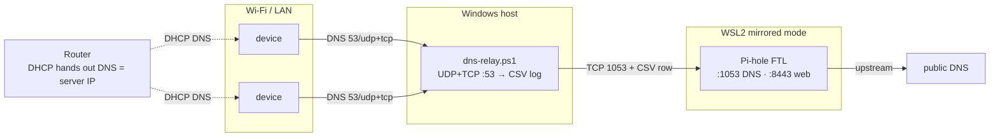
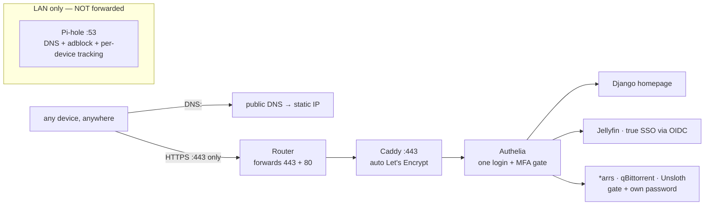

# Architecture

This document is the **map of the homeserver**: what runs on it, how the pieces
fit together, and the target design we are converging toward. It is written to be
read cold — a future you (or anyone) should understand the whole box from this
page plus the per-service READMEs.

> **Convention:** this repo is public, so nothing here names a specific device,
> IP, MAC, hostname, or user. A "device" is just a device; concrete values live in
> a gitignored `.env` on the real machine.

## Services

| Service | Role | Port(s) | Install type |
|---|---|---|---|
| **Pi-hole FTL** | DNS + ad blocking + per-device tracking | 1053 (DNS), 8443 (web UI) | native, in WSL2 |
| **Django homepage** (`web/`) | Dashboard / entry point to all services | 80 | our code |
| **Jellyfin** | Media streaming | 8096 | upstream |
| **Radarr** | Movie automation | 7878 | upstream |
| **Sonarr** | TV automation | 8989 | upstream |
| **Prowlarr** | Indexer manager for the *arrs | 9696 | upstream |
| **Seerr** | Request UI for Radarr/Sonarr | 5055 | upstream |
| **Bazarr** | Subtitle automation | 6767 | upstream |
| **FlareSolverr** | CAPTCHA / anti-bot proxy for the *arrs | 8191 | upstream |
| **qBittorrent (headless)** | Download client | 8080 (webui) | upstream |
| **Unsloth** | Local LLM studio | 8888 | upstream |

"Upstream" means a stock application install — documented here, not committed as
code. Only `web/` and the per-service setup scripts are genuinely ours.

## Current topology (WSL2 + Windows relay)

The server currently runs Pi-hole inside **WSL2 in mirrored networking mode** on a
Windows host. Mirrored mode shares the host's LAN IP, but has one quirk: inbound
**UDP/53 to the host IP is consumed by the Windows stack and never reaches WSL**.
So FTL does not listen on :53; instead a small **Windows-side relay** binds :53
(UDP + TCP), forwards each query to FTL over TCP, and logs every query for
per-device tracking.

**Per-device tracking:** the relay writes `timestamp, clientIP, domain` to a CSV.
That CSV is the source of truth for "which domains did *this* device query,"
because Pi-hole itself only ever sees the host IP as the client (the relay sits in
between). The CSV is **never committed** — it is browsing history.

> This whole relay exists *only* because of WSL2. On native Linux, FTL binds :53
> directly and the relay disappears. See `migrate/README.md`.

## Target architecture (single port + HTTPS + unified login)

The converged goal: reach the **entire** homeserver through **one port (443)**
over **HTTPS**, with a single login, from inside *and* outside the LAN — without
installing anything on client devices.

### Decisions and rationale

- **Single port via hostname routing.** Caddy routes by subdomain (one per
  service). Sub-paths were rejected because qBittorrent/Seerr/Unsloth have no
  base-path option. See `gateway/README.md`.
- **HTTPS with zero per-device installs.** Let's Encrypt issues real, universally
  trusted certs for the public DDNS hostname; Caddy renews them automatically. No
  internal CA, nothing to install on phones/laptops.
- **Remote access without client apps.** Only 443 (+80 for cert validation) are
  forwarded. Tailscale/WireGuard/ZeroTier were considered and rejected (they need
  a client app on every device).
- **Port 53 is NOT forwarded.** Forwarding it would make the box an open resolver
  (DNS amplification risk), it isn't needed for remote access (devices use their
  own DNS to reach the DDNS name), and it would corrupt per-device tracking
  (remote queries would all be attributed to the router's WAN IP). Pi-hole stays
  LAN-only.
- **Unified login.** Authelia sits in front of everything as an auth gate (works
  for any app) with one identity + TOTP MFA. Jellyfin gets true SSO via OIDC; the
  rest keep their own password field, set to the same credential.
- **Hiding services later.** The Caddyfile is generated from a per-service config
  with an `exposed` flag. Flipping it off removes a service from public DNS while
  keeping it reachable on the LAN via Pi-hole.

### Exposure hygiene (because we're internet-facing)

- Only publish hostnames for services you actually want remote; leave the rest
  resolvable only via the LAN Pi-hole.
- Every exposed service has built-in login; add **fail2ban** in front of Caddy.
- Keep anything without auth LAN-only.

## Ports table (current)

| Port | Service | Notes |
|---|---|---|
| 80 | Django homepage | will move behind Caddy in the target design |
| 53 (UDP+TCP) | Windows relay → FTL | LAN only, never forwarded |
| 1053 | Pi-hole FTL DNS | internal to the relay path |
| 8443 | Pi-hole web UI | self-signed; linked from homepage |
| 8096 / 7878 / 8989 / 9696 / 5055 / 6767 | Jellyfin / Radarr / Sonarr / Prowlarr / Seerr / Bazarr | |
| 8191 | FlareSolverr | internal to the *arrs |
| 8080 | qBittorrent webui | |
| 8888 | Unsloth | |

In the target design, all of these sit behind Caddy on :443 and are no longer
individually exposed.
