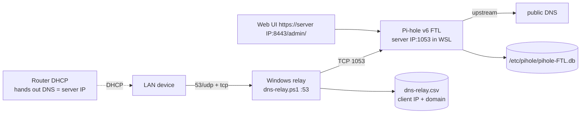

# Pi-hole — DNS tracker + ad blocker (WSL2 mirrored mode)

Native (no Docker) Pi-hole v6, serving two purposes:

1. **Track a specific device** — see which domains it queries (per-device).
2. **Ad-blocking** — block ads/tracking network-wide.

Devices reach Pi-hole automatically: the router's DHCP server hands out the
server's LAN IP as the DNS address, so no per-device configuration is needed.

> This folder is a **public-repo example**: no real IPs, hostnames, or usernames.
> Replace the `<...>` placeholders with your own values (or set the matching env
> vars — see `.env.example` at the repo root).

## Architecture ("option 2": mirrored mode + Windows relay)

WSL2 runs in **mirrored networking** mode: it shares the Windows host's LAN IP.
The catch: in mirrored mode, inbound **UDP/53 destined for the host IP is
consumed by the Windows network stack and never reaches WSL** (all other ports
flow fine). So FTL does *not* listen on :53. Instead:

- **FTL listens on port 1053** (TCP + UDP) at `<SERVER_IP>` inside WSL.
- A **Windows-side relay** (`dns-relay.ps1` + `dns-relay-tcp.ps1`) binds
  **UDP :53 and TCP :53**, forwards every query to FTL over **TCP/1053**
  (DNS-over-TCP framing), and returns the answer.
- The relay logs `timestamp,clientIP,domain` to a CSV next to the scripts.
  **This CSV is the source of truth for per-device tracking**, because Pi-hole
  itself only ever sees the host IP as the client (the relay is in between).

TCP :53 matters: resolvers fall back to TCP when a UDP response is too large, or
probe TCP before trusting a server — without it they may abandon us and use the
fallback DNS.



Key choices and why:

- **Pi-hole v6** (native). v6 has a **built-in web server** — no lighttpd/nginx;
  FTL serves the UI itself.
- **FTL on port 1053, not :53.** `dns.listeningMode = "NONE"` + explicit
  `dnsmasq_lines` binding only the LAN IP. WSL2 keeps its own listeners on
  `127.0.0.53/.54:53` and `10.255.255.254:53`, so a wildcard :53 bind fails with
  "Address in use"; BIND mode alone is *not* enough (FTL still auto-binds the WSL
  loopback, which kills the DNS engine). `NONE` + explicit `listen-address` avoids
  every collision. The Windows host's *own* DNS stays untouched (WSL-managed).
- **Web UI on HTTPS 8443** at `https://<SERVER_IP>:8443/admin/` (self-signed —
  browser warning is normal). Ports 80/443 belong to the Django homepage, which
  FTL's default webserver ports would otherwise squat on and crash-loop.
- **Upstream DNS: 1.1.1.1 + 9.9.9.9** (change in Web UI → DNS Settings).
- **Router-wide via DHCP**: router hands out the server IP as DNS server 1
  (fallback `1.1.1.1` as server 2), so every device uses Pi-hole automatically.

## Layout

| Path | What |
|---|---|
| `/opt/pihole/`, `/etc/pihole/` | Pi-hole app + FTL config/DB — **never commit** (secrets, privacy) |
| relay CSV / logs (next to the scripts) | Per-device log — **never commit** (client IPs + domains) |
| `homeserver-infra/pihole/` (this folder) | Deploy scripts + docs — what goes in git |

### Files in this folder

| File | Purpose |
|---|---|
| `wsl2-setup.sh` | Post-install FTL config: port 1053, bind LAN IP only, web UI on 8443. Idempotent; run as root. |
| `dns-relay.ps1` | **The relay** — UDP :53 leg + supervisor. Waits for FTL (retries forever), forwards to TCP/1053, logs the CSV, and keeps the TCP child alive. |
| `dns-relay-tcp.ps1` | TCP :53 leg (child process of the above). Two processes because PowerShell 5.1 background threads can't see the parent script's scope. |
| `device_report.py` | Per-device reports. `--relay-csv <path>` reads the relay CSV (the mirrored-mode source of truth); default mode reads the FTL DB. `--all-devices` lists every client + top domains. |
| `check_health.sh` | Sanity check: FTL service, :1053 bind, web UI on 8443, live test query via :53 (exercises the relay). |
| `relay-watchdog.ps1` | Restarts the relay if its UDP :53 listener is gone (the parent has no supervisor of its own — see Operations). Run from a scheduled task every few minutes. |
| `windows-firewall.ps1` | One-time inbound Windows Firewall rules for :53 (UDP+TCP) and :8443. Run once as Administrator. |
| `diagnostics/` | Historical root-cause scripts from bring-up (NAT/portproxy attempt, Dnscache dead end, one-off proofs). See its README. Not needed for operation. |

## Setup (one-time)

1. **Install Pi-hole v6** with the official script:
   `curl -fsSL https://install.pi-hole.net | bash`
   (answer the prompts; enable query logging — required for tracking).
2. **WSL2 fix** (as root): `sudo bash wsl2-setup.sh` — sets FTL to port 1053,
   binds only the LAN IP, moves the web UI to 8443, restarts FTL, verifies.
3. **Windows side**:
   - Ensure `%USERPROFILE%\.wslconfig` contains:
     ```ini
     [wsl2]
     networkingMode=mirrored
     dnsTunneling=false

     [experimental]
     hostAddressLoopback=true
     ```
     `hostAddressLoopback=true` is required so Windows can reach WSL via the
     host IP (the relay's forwarding leg). Then `wsl --shutdown` once to apply.
   - Run `windows-firewall.ps1` once as Administrator (inbound :53 UDP+TCP, :8443).
   - Copy `dns-relay.ps1` + `dns-relay-tcp.ps1` to a folder on the Windows host
     (e.g. `%USERPROFILE%`). **Fill in the server's LAN IP**: either set the
     `PIHOLE_TARGET_HOST` environment variable, or replace the `192.168.1.X`
     placeholder at the top of each script with your real IP. (The repo ships
     the placeholder for public-repo hygiene — a relay started without this fix
     will sit in "Waiting for Pi-hole" forever.) CSV/logs are written next to
     the scripts unless `RELAY_DIR` is set.
   - Start the relay (from an **elevated** PowerShell — port 53 requires admin):
     `powershell -NoProfile -ExecutionPolicy Bypass -File dns-relay.ps1`
   - **Auto-start** — the relay binds port 53, which is below 1024, so Windows only
     lets an **elevated** process bind it. The task must therefore run with highest
     privileges (`/RL HIGHEST`); a non-elevated task will start but fail to bind :53.
     Register both tasks **with stored credentials** (`/RU` + `/RP`) — see the note
     below on why this also kills the console-window flash:
     ```powershell
     $cred = Get-Credential   # account name + password; Task Scheduler stores it
     schtasks /Create /SC ONLOGON /TN "Pi-hole DNS Relay" /TR "powershell.exe -NoProfile -ExecutionPolicy Bypass -WindowStyle Hidden -File %USERPROFILE%\dns-relay.ps1" /RU $cred.UserName /RP $cred.GetNetworkCredential().Password /RL HIGHEST /F
     ```
   - **Watchdog** — must *also* run elevated (`/RL HIGHEST`), because it has to kill
     and restart the (elevated) relay; a non-elevated watchdog gets "Access denied"
     and silently cannot self-heal. The relay's parent process has no supervisor of
     its own: if it is killed externally (window closed, sign-out), UDP :53 dies
     silently while the orphaned TCP child keeps running. This task restarts the
     relay whenever the UDP listener is missing:
     ```powershell
     schtasks /Create /SC MINUTE /MO 5 /TN "Pi-hole DNS Relay Watchdog" /TR "powershell.exe -NoProfile -ExecutionPolicy Bypass -WindowStyle Hidden -File %USERPROFILE%\relay-watchdog.ps1" /RU $cred.UserName /RP $cred.GetNetworkCredential().Password /RL HIGHEST /F
     ```
     > **Why stored credentials (and the window flash):** a task registered *without*
     > `/RU`/`/RP` runs in "Run only when user is logged on" mode, so Task Scheduler
     > allocates a real console for every run — you see a brief PowerShell window
     > flash (every 5 minutes from the watchdog). `-WindowStyle Hidden` only hides
     > the window *after* PowerShell starts; it cannot prevent the initial flash.
     > With stored credentials the task runs in session 0 with no console at all,
     > and also keeps running when nobody is logged in. Verify:
     > `(Get-ScheduledTask "Pi-hole DNS Relay").Principal.LogonType` should print
     > `Password`, not `Interactive`. To fix an existing task without recreating it:
     > Task Scheduler → Properties → General → **"Run whether user is logged on or
     > not"** (prompts for the password), or delete + re-run the commands above.
4. **Router**: admin UI → LAN/DHCP settings, set DNS Server 1 = the server's LAN IP
   (optionally `1.1.1.1` as Server 2). Every device that gets an IP from this
   router then uses Pi-hole automatically.
5. **Per-device caveat — Private DNS (DoT)**: some devices (notably Android) have a
   *Private DNS* / DNS-over-TLS setting. If it is *On*, the device encrypts its DNS
   straight to a provider and **ignores the DHCP server**, bypassing Pi-hole
   entirely. Set it to **Off** on any device you want covered (Android: Settings →
   Connections → More connection settings → Private DNS → Off). A device that only
   ever shows `_dns.resolver.arpa` in the CSV is probing us but resolving elsewhere.
6. Verify: `./check_health.sh`, then browse something on a device and run
   `./device_report.py --relay-csv <path-to-relay-csv> --all-devices`.

## Tracking a specific device

The relay CSV (format `timestamp,clientIP,domain`) is the per-device source of
truth in mirrored mode — Pi-hole's own DB only sees the host IP as client.

- See who is talking to us at all:
  `./device_report.py --relay-csv <path-to-relay-csv> --all-devices`
- Top domains for one device, last 7 days:
  `./device_report.py --relay-csv <path-to-relay-csv> --client <DEVICE_IP> --hours 168`
- `--all` for the full list; `--blocked-only` filters to domains in the blocklist
  (heuristic, since the CSV has no per-query status).

Caveats: DNS shows **domains, not full URLs**; apps/browsers with their own
DoH/DoT bypass Pi-hole entirely; if a device's IP changes (DHCP), update the
report command or add a DHCP reservation on the router. The CSV grows forever —
trim it periodically (e.g. keep 30 days) if you care about size.

## Operations

- Web UI: `https://<SERVER_IP>:8443/admin/` (self-signed cert). Also linked from
  the Django homepage ("Management" section).
- Health check: `./check_health.sh`.
- **The relay is a plain process, not a service.** If it isn't running, :53 gets
  "connection refused" and devices fall back to their secondary DNS. Check with
  `netstat -ano | findstr :53` on Windows (expect one UDP + one TCP listener) and
  look at the relay log next to the scripts. The supervisor restarts the TCP leg
  automatically, but if the *parent* dies you must start it again (or rely on the
  logon scheduled task).
- **Testing reachability**: test from a real LAN device (`nslookup example.com <SERVER_IP>`),
  not from Windows itself — in mirrored mode Windows short-circuits traffic to its
  own IP, so local tests can mislead.
- Blocklists: Web UI → Denylists (defaults installed; add e.g. AdGuard DNS filter).
- If the LAN IP ever changes: re-run `wsl2-setup.sh`, update `PIHOLE_TARGET_HOST`
  (or the placeholder at the top of both relay scripts), and update the router's
  DHCP DNS setting.

## Git / secrets policy

This folder is committed to a **public** repo. Never commit: `/etc/pihole/*`
(credentials, TLS key), `pihole-FTL.db`, or the relay CSV (client IPs + query
history = privacy-sensitive — it *is* the tracking data), anything under
`/var/lib` or `/opt/pihole`. The root `.gitignore` covers the in-folder cases;
the sensitive files live outside this folder anyway.
